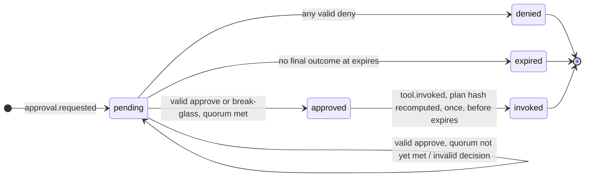

# A3 Approval Protocol

**Version:** 1.0.0
**Status:** Stable. Changes follow the versioning rules in the [README](../README.md#conventions).
**Licence:** Community Specification License 1.0 ([LICENSE.md](../LICENSE.md)). Independent implementation is explicitly permitted and encouraged.
**Depends on:** [Decision Trace Format](decision-trace.md) 1.0 — approvals are recorded as trace records and verified over a trace.

Every agent control plane can put a human in front of a tool call. This protocol specifies what most of them leave undefined: **what exactly was approved**, so that a verifier can later prove the action that ran is the action a human saw — and that nothing else ran under that approval.

The words MUST, SHOULD and MAY are used as in RFC 2119.

---

## 1. The problem this solves

An approval that is not bound to a specific action is theatre. Between the moment an approver clicks *approve* and the moment the tool is invoked, the agent can re-plan, the arguments can change, the target can move. A log line saying "approved" proves nothing about what followed.

This protocol makes the approval a cryptographic commitment to a **plan**: the concrete, fully resolved action. The gateway that executes the action recomputes the plan's hash at the moment of invocation and refuses if it differs. The trace records the plan the approver saw, every decision, and the plan that ran, so that all three can be compared after the fact by someone who was not there.

Three properties follow:

| Property | Meaning |
|---|---|
| **Binding** | An approval applies to one plan, identified by its hash. Any change to the plan voids it. |
| **Single use** | An approved plan is invoked at most once. |
| **Verifiability** | Given only the trace and the key set, a verifier can confirm that every approval-gated action was approved, by eligible approvers, in quorum, before expiry, and ran unchanged. |

---

## 2. The plan and its hash

A **plan** is a JSON object describing the action exactly as it will run:

```json
{
  "v": "1.0",
  "trace_id": "019267b4-…",
  "task_id": "task-4471",
  "agent": {"name": "order-analyst", "namespace": "support"},
  "originating_principal": {"type": "human", "id": "sub|8f3a…"},
  "action": {
    "tool": "refund-processor",
    "operation": "issue-refund",
    "arguments": {"order": "A-1043", "line": 3, "amount": "42.50"}
  },
  "side_effect": "mutating"
}
```

| Field | Why it is in the plan |
|---|---|
| `v` | Protocol version. |
| `trace_id`, `task_id` | An approval given in one task cannot be replayed in another. |
| `agent` | Which agent definition will act. |
| `originating_principal` | On whose authority. Needed for separation of duties (§5.3). |
| `action` | The tool, operation and **fully resolved** arguments. No templates, no late binding. |
| `side_effect` | The classification the approver is being asked to accept. |

**`plan_hash = sha256(JCS(plan))`**, encoded `sha256:<64 hex>`, using RFC 8785 canonicalisation exactly as the trace format does. Two implementations that agree on the plan object agree on the hash.

Deliberately **not** in the plan: the instance — an instance may restart between approval and invocation without voiding the approval; and the request's expiry — that belongs to the request, not the action.

Deviation is exact. There is no partial or fuzzy match in this version; a plan whose arguments differ by one byte is a different plan.

### 2.1 What is not plan binding

The guarantee in §1 rests entirely on one property: the hash covers an action that is **fully resolved**, so the deed that runs is the deed that was accepted. An implementation MUST NOT put a hash of anything else in `plan_hash`, MUST NOT describe a weaker construction as plan binding, and MUST NOT report `E_PLAN_MISMATCH` about one.

There is a weaker construction that some deployments will need, and naming it here costs less than letting each of them name it differently. Call it **plan-class authorisation**: one decision covering a described set of future actions rather than a single resolved one — the same operation against any line of one order, any actuation within a stated envelope, anything that must be authorised before the acting party can be reached. Where an approver is reliably reachable it is an unnecessary weakening and this specification's answer is to use plan binding. Where one is not — an emitter disconnected at the moment the question arises ([decision-trace.md](decision-trace.md) §5.1) — the alternative to it is not stronger authorisation, it is an agent that stops.

It is weaker in a way worth stating precisely rather than in general terms. Under plan binding an approver accepts a deed, and a verifier confirms afterwards that the deed and the acceptance are the same object; the question is closed by arithmetic. Under plan-class authorisation an approver accepts a *description*, written before the deed existed, and a verifier can confirm only that the deed matched the description. That moves the load-bearing question from cryptography to whoever wrote the description, and no amount of hashing moves it back.

This version does not specify it. So that the room stays open and an extension cannot collide with this document, **`class_hash` and the error prefix `E_CLASS_` are reserved**, and a verifier of this version MUST NOT accept a `class_hash` in place of a `plan_hash`: an invocation carrying one is not plan-bound, whatever else it may be.

---

## 3. Records

The protocol defines the content of three record kinds from the trace format. Fields marked **required** are in addition to what the trace format already requires for the kind.

### 3.1 `approval.requested`

Emitted by the component that decided approval is needed, when it suspends the action.

| Field | Required | Meaning |
|---|---|---|
| `request_id` | yes | Unique within the trace. |
| `plan_hash` | yes | Hash of `plan`. |
| `plan` | yes | The plan object of §2, verbatim. Approvers decide on this; verifiers rehash it. |
| `policy` | yes | The policy that required approval. |
| `approvers_from` | yes | Groups whose members may decide. |
| `quorum` | yes | Number of distinct valid approvals required. ≥ 1. |
| `separation_of_duties` | yes | Whether the originating principal is barred from approving. |
| `step_up` | yes | `"none"` or `"mfa"`: what the decision must carry. |
| `expires` | yes | RFC 3339 UTC. Both the decision and the invocation must happen before this. |
| `reasoning_summary` | no | The agent's stated reason, for the approver. |
| `blast_radius` | no | Estimated affected set. |
| `dry_run` | no | Result of a dry run, or its hash. |
| `escalates` | no | `request_id` of an earlier request this one replaces after timeout. |
| `break_glass_groups` | no | Groups whose members may break glass on this request (§5.6). Absent means break-glass is not permitted. |

### 3.2 `approval.decided`

Emitted by the approval service **once per decision**, including decisions it rejects as invalid, and once for expiry. The record carries the running tally so the outcome is verifiable at every step.

| Field | Required | Meaning |
|---|---|---|
| `request_id` | yes | |
| `plan_hash` | yes | MUST equal the request's. |
| `decision` | yes | `approve` \| `deny` \| `expired` \| `break-glass`. |
| `approver` | yes | `{"type": "human"\|"service"\|"component", "id": …, "groups": [...]}`. For `expired`, the approval-service component. `groups` MUST be present for `approve` and `break-glass`. |
| `step_up` | yes | Whether step-up authentication was performed for this decision. |
| `valid` | yes | Whether the decision counts. `false` with `invalid_reason` when the approver was ineligible, self-approving, or otherwise barred. Invalid decisions are recorded — an attempt to self-approve is itself evidence — but never counted. |
| `invalid_reason` | when `valid` is false | |
| `tally` | yes | `{"approvals": n, "denials": m, "quorum": q}` after applying this decision. |
| `outcome` | yes | `pending` \| `approved` \| `denied` \| `expired` after applying this decision. |
| `on_behalf_of` | no | `{"type", "id", "groups"}`: the principal whose authority was exercised, when the approver acted as a deputy (§5.5). Absent means the approver decided on their own. |
| `comment` | no | The approver's note. |
| `break_glass` | when `decision` is `break-glass` | `{"reason": …}`. |
| `approver_sig` | no | `{"kid", "sig"}`: the approver's own Ed25519 signature over `utf8(sha256(JCS({request_id, plan_hash, decision})))`. Optional; gives non-repudiation independent of the service's key. |

### 3.3 `tool.invoked`

For an approval-gated invocation, two fields are **required** beyond the trace format's:

| Field | Meaning |
|---|---|
| `plan_hash` | The approved plan's hash. |
| `approval_request_id` | The request whose approval authorises this invocation. |

The record's own `tool`, `operation` and `arguments` are what actually ran. A verifier rebuilds the plan from them and the trace's context and rehashes it (§6 step 4). This is the binding check.

---

## 4. Lifecycle

The rules below are normative. The diagram summarises them.



Rules:

1. **Outcome is a pure function of the valid decisions in order.** After each decision: any valid `deny` → `denied`, final. Else if distinct valid approvers (including `break-glass`) ≥ `quorum` → `approved`, final. Else `pending`.
2. **A final outcome does not change.** Decisions recorded after a final outcome MUST carry `valid: false` with `invalid_reason: "request already resolved"`.
3. **Expiry.** If no final outcome has been reached at `expires`, the service MUST record `decision: expired`, `outcome: expired`. A request with `escalates` MAY then be raised naming the new groups; it is a new request with a new `request_id` and its own expiry, bound to the same `plan_hash`.
4. **Invocation.** The gateway MUST invoke only after observing `outcome: approved`, MUST recompute the plan hash from the action it is about to perform and refuse on mismatch, MUST invoke before `expires`, and MUST NOT invoke the same `request_id` twice.
5. **Batches.** Approving several actions at once is several requests, each plan-bound and individually recorded. There is no batch object.

---

## 5. Decision validity

A decision is **valid** only if every applicable rule holds. An invalid decision is recorded with `valid: false` and does not affect the tally.

### 5.1 Eligibility
The approver's `groups` MUST intersect the request's `approvers_from`. Membership is evaluated **at decision time** by the identity interface, not at request time.

Where the decision carries `on_behalf_of` (§5.5), eligibility is evaluated against **that principal's** groups instead. A deputy uses lent authority; the deputy's own groups are irrelevant to whether they may decide, and equally irrelevant to how far they may.

### 5.2 Distinctness
Each approver counts once per request. A second `approve` from the same `approver.id` is `valid: false`, `invalid_reason: "duplicate approver"`.

### 5.3 Separation of duties
When the request has `separation_of_duties: true`, an `approve` or `break-glass` whose `approver.id` equals the plan's `originating_principal.id` is `valid: false`, `invalid_reason: "self-approval"`. Denials are always permitted from anyone eligible.

The same rule applies to the **lender**: when the request has `separation_of_duties: true` and the decision's `on_behalf_of.id` equals the plan's `originating_principal.id`, the decision is `valid: false`, `invalid_reason: "deputised by the originating principal"`. Otherwise the person whose work is being approved could lend their approval authority to somebody else and have that signature stand in for the independent one the policy asked for, which is self-approval with an extra step.

### 5.4 Step-up
When the request has `step_up: "mfa"`, an `approve` with `step_up: false` is `valid: false`, `invalid_reason: "step-up required"`.

### 5.5 Deputised authority

A decision MAY carry `on_behalf_of`: `{"type", "id", "groups"}`, the principal whose authority is being exercised. It changes who may decide and nothing else.

- **Eligibility** is judged on `on_behalf_of.groups` (§5.1).
- **Distinctness** is judged on `approver.id` (§5.2). One person is one signature however many people's authority they hold: an approver cannot satisfy a quorum of two by deciding once as themselves and once as a deputy.
- **Separation of duties** applies to both identities (§5.3).
- **Step-up** is the approver's to present (§5.4). Authority can be lent; a fresh authentication cannot.
- `on_behalf_of.id` equal to `approver.id` is `valid: false`, `invalid_reason: "deputised to the approver themselves"`.
- A deputy MUST NOT appoint a deputy with authority they hold only as a deputy. A verifier cannot see this from the trace — the record shows one lender, not a chain — so it is a requirement on the implementation appointing the deputy, not a verification rule.

How a deputy is appointed is outside this protocol. What the protocol requires is that both identities appear on the record: a deputy is lent authority, not identity, and an audit that could not see the decision was made by somebody other than the person entitled to make it would be missing the fact that matters most about it.

### 5.6 Break-glass
`break-glass` counts as an approval that alone satisfies quorum, regardless of `quorum`, when the approver's groups intersect the policy's break-glass groups. It MUST carry `break_glass.reason`. It is subject to separation of duties. Implementations MUST alert on it in real time and SHOULD require post-hoc review; both are outside the trace.

---

## 6. Verification procedure

Runs over a trace that has already passed the Decision Trace Format verifier. Input: the trace. Output: `VALID` or `INVALID` with every error found, each naming the `seq`.

Maintain, per `request_id`: the request record; the set of valid approvers; the denial count; the current outcome; whether it has been invoked.

For each record in `seq` order:

1. **Request.** On `approval.requested`: `plan_hash` equals `sha256(JCS(plan))`, else `E_PLAN_HASH`. `plan.trace_id` equals the trace's, `plan.task_id` equals the trace's task, else `E_PLAN_SCOPE`. `quorum ≥ 1`. Duplicate `request_id` is `E_REQUEST_DUPLICATE`.
2. **Decision.** On `approval.decided`: a request with that `request_id` exists earlier, else `E_DECISION_ORDER`. `plan_hash` equals the request's, else `E_PLAN_MISMATCH`. Recompute validity per §5 and compare with `valid`/`invalid_reason`; mismatch is `E_VALIDITY`. Apply the decision and recompute `tally` and `outcome`; mismatch with the record is `E_OUTCOME`. A `decision: expired` with `ts` before `expires` is `E_OUTCOME`.
3. **Gated invocation.** On `tool.invoked` carrying `approval_request_id`: the request exists (`E_APPROVAL_MISSING`); its outcome at this point is `approved` (`E_APPROVAL_MISSING`); `ts` is before `expires` (`E_APPROVAL_EXPIRED`); the request has not already been invoked (`E_APPROVAL_REUSED`).
4. **Binding.** Rebuild the plan from the invocation: `v`, the trace's `trace_id` and `task_id`, `agent` and `originating_principal` from `task.admitted`, `action` from the record's `tool`, `operation`, `arguments`, and the record's `side_effect`. Its hash MUST equal the record's `plan_hash` and the request's. Else `E_PLAN_MISMATCH`.
5. **Ungated invocation.** A `tool.invoked` with `plan_hash` but no `approval_request_id`, or vice versa, is `E_STRUCTURE`.

A verifier MUST report every error, not stop at the first.

What the verifier **cannot** establish, and does not claim to: whether an invocation *should* have been gated. That depends on policy, which lives outside the trace. The gateway's `policy.evaluated` records show what it decided; auditing the policy itself is a separate exercise.

---

## 7. Standalone implementation

This protocol is implementable by a runtime that uses no other component of any particular runtime. The minimum is:

- Build the plan object of §2 for any action that needs approval, hash it with JCS + SHA-256.
- Emit the three records of §3 into a Decision Trace Format trace.
- Apply the rules of §4–5 when collecting decisions.
- Recompute the hash at invocation and refuse on mismatch.

How decisions are *collected* — a web page, a chat message, a CLI, a ticket — is not specified and does not matter to verification. What matters is what gets recorded.

---

## 8. Security considerations

- **Approver identity.** The protocol records who the approval service says approved. That is only as strong as the service's identity integration. `approver_sig` lets an approver sign independently; deployments that need non-repudiation against a compromised service should require it.
- **TOCTOU.** The hash MUST be recomputed from the exact request that will be sent to the tool, at the gateway, immediately before sending. Recomputing earlier — or trusting a hash supplied by the agent — reintroduces the gap this protocol closes.
- **Replay.** `trace_id` and `task_id` in the plan stop cross-task replay; single-use stops within-task replay; `expires` bounds the window.
- **Fatigue.** Nothing here prevents an approver from rubber-stamping. Measuring approval load and blast-radius-scaled quorum are policy concerns; the protocol makes them auditable by recording every decision.
- **What the approver sees.** The approver MUST be shown the plan that was hashed, not a summary of it. A UI that shows "refund order A-1043" while the plan says the whole order rather than one line has not obtained an informed approval, whatever the hash says.

---

## 9. Conformance

Two conformance roles: **Requester/Executor** (emits requests and gated invocations that verify) and **Verifier** (produces the specified result for every vector in `vectors/approval-protocol/`). The initial vectors: a valid single-approver flow; quorum of two reached; a denial; expiry; invocation after expiry; a self-approval recorded invalid then a valid approval; an ineligible approver; a duplicate approver; a decision before its request; an invocation whose arguments differ from the approved plan; the same approval used twice; a break-glass approval; a request whose `plan_hash` does not match its `plan`.

---

## 10. Example

A mutating call, one approver, quorum 1, invoked before expiry. Envelope fields abbreviated.

```json
{"seq":5,"kind":"policy.evaluated","actor":{"type":"component","id":"gateway"},"content":{"point":"pre-action","policy":"large-refunds","rule":"matches","decision":"require-approval","reason":"…"}}
{"seq":6,"kind":"approval.requested","actor":{"type":"component","id":"gateway"},"content":{"request_id":"ar-7c1e","plan_hash":"sha256:9b1c…","plan":{"v":"1.0","trace_id":"019267b4-…","task_id":"task-4471","agent":{"name":"order-analyst","namespace":"support"},"originating_principal":{"type":"human","id":"sub|8f3a"},"action":{"tool":"refund-processor","operation":"issue-refund","arguments":{"order":"A-1043","line":3,"amount":"42.50"}},"side_effect":"mutating"},"policy":"large-refunds","approvers_from":["support-oncall"],"quorum":1,"separation_of_duties":true,"step_up":"none","expires":"2026-09-16T14:30:00.000Z","reasoning_summary":"Line 3 was lost in transit and has not scanned since the depot; refunding that line is the documented remedy."}}
{"seq":7,"kind":"approval.decided","actor":{"type":"component","id":"approvals"},"content":{"request_id":"ar-7c1e","plan_hash":"sha256:9b1c…","decision":"approve","approver":{"type":"human","id":"sub|c04d","groups":["support-oncall"]},"step_up":false,"valid":true,"tally":{"approvals":1,"denials":0,"quorum":1},"outcome":"approved","comment":"agreed, bounce it"}}
{"seq":8,"kind":"policy.evaluated","actor":{"type":"component","id":"gateway"},"content":{"point":"pre-action","policy":"approval","rule":"plan-bound","decision":"allow","reason":"request ar-7c1e approved; plan hash matches"}}
{"seq":9,"kind":"tool.invoked","actor":{"type":"agent","id":"order-analyst-7d9f"},"content":{"call_id":"c-02","tool":"refund-processor","operation":"issue-refund","arguments":{"order":"A-1043","line":3,"amount":"42.50"},"side_effect":"mutating","plan_hash":"sha256:9b1c…","approval_request_id":"ar-7c1e"}}
{"seq":10,"kind":"tool.completed","actor":{"type":"component","id":"gateway"},"content":{"call_id":"c-02","status":"ok","result_hash":"sha256:…","duration_ms":2140,"trust_level":"tool-result"}}
```

Change the refunded line from 3 to 2 in record 9 and the verifier reports `E_PLAN_MISMATCH` at seq 9: the action that ran is not the action that was approved.

---

## 11. Settled in 1.0, and future work

Settled:

1. **`approver_sig` is optional.** Without it, the record says the approval service attests that the approver decided. With it, the record says the approver decided. A deployment that needs non-repudiation requires it by policy. A future profile may make it mandatory.
2. **Approval binds one exact plan.** Plan-class authorisation is named and fenced off in §2.1, with `class_hash` and `E_CLASS_` reserved for it. It will be specified as a profile, with its own vectors, and never changes what an exact approval means.
3. **One expiry window.** `expires` bounds both the decision and the invocation. A separate, shorter invocation window can be added later as an optional field without changing the meaning of `expires`.
4. **`blast_radius` is informational.** It is shown to approvers and recorded, and a verifier never interprets it. A shared vocabulary can be added in a minor version.
